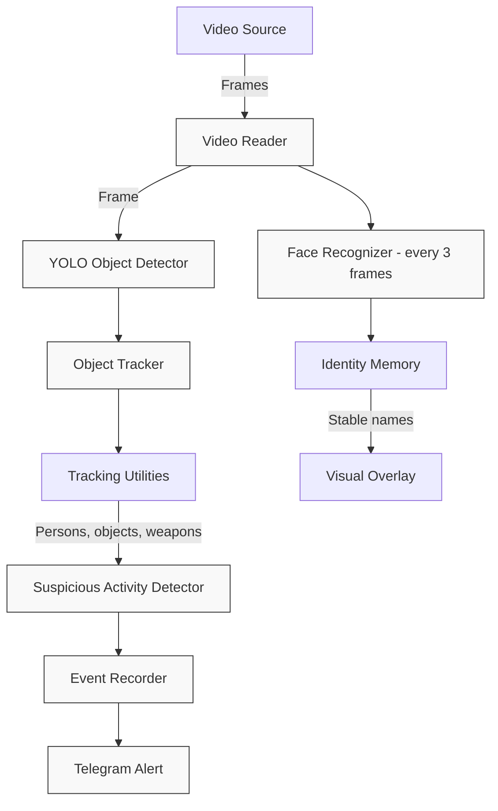

# AI Suspicious Activity Detection

A computer vision system for analyzing video streams and identifying potentially suspicious activities, including theft, fights, and weapon appearances. The system combines YOLO-based object detection, multi-object tracking, face recognition, activity analysis, video evidence recording, and Telegram alerts.

## 📖 Overview

- **Video Input:** Supports configured RTSP camera streams and local video files.
- **Object Detection:** Uses YOLO-based object detection.
- **Activity Analysis:** Applies rule-based heuristics to identify potential theft, fights, and weapon-related events.
- **Object Tracking:** Tracks detected objects across video frames.
- **Face Recognition:** Supports an optional face-recognition pipeline.
- **Event Recording:** Saves video clips associated with detected events.
- **Telegram Alerts:** Supports sending incident notifications through a Telegram bot.

## ✨ Features

- Multi-category suspicious activity detection.
- Movement-based fight detection.
- Object displacement and proximity-based theft detection.
- Weapon-related object detection and proximity analysis.
- Temporal event confirmation and smoothing.
- Object tracking and identity association.
- Configurable detection thresholds.
- RTSP video-stream handling.
- Event clip recording.
- Asynchronous Telegram alert delivery.
- Modular architecture for extending activity-detection rules.

## 🏗️ Architecture



## 🛠️ Installation

### 1. Clone the Repository

```bash
git clone https://github.com/YOUR_USERNAME/AI-Suspicious-Activity-Detection.git
cd AI-Suspicious-Activity-Detection
```

Replace `YOUR_USERNAME` with your GitHub username.

### 2. Create a Virtual Environment

On macOS or Linux:

```bash
python3 -m venv .venv
source .venv/bin/activate
```

### 3. Install Dependencies

```bash
python -m pip install --upgrade pip
pip install -r requirements.txt
```

### 4. Configure Environment Variables

Create a `.env` file in the project root. Add the environment variables required by your implementation.

Example:

```dotenv
RTSP_URL=
TELEGRAM_BOT_TOKEN=
TELEGRAM_CHAT_ID=
```

Use the exact variable names expected by your application. Keep credentials private and never commit your `.env` file.

For local video testing, configure the appropriate video path in your application.

### 5. Configure Model Weights

Obtain the model weights required by your configuration and place them at the expected paths.

Model weight files are excluded from this repository through `.gitignore`. Verify the configured model paths before running the application.

## ▶️ Running the Application

Activate the virtual environment:

```bash
source .venv/bin/activate
```

Start the application:

```bash
python main.py
```

Ensure that the video source, model paths, and required environment variables are configured before starting the system.

If the application opens a display window, use the exit key configured by the application to stop processing.

## 📤 Telegram Alerts

When Telegram alerts are configured, the system can send notifications about detected events.

Depending on the implementation, notifications may include:
- The detected activity category.
- An incident snapshot.
- A recorded video clip.

Alert delivery requires a valid Telegram bot token and chat ID. Keep these values in environment variables rather than hardcoding them in source files.

## 📂 Project Structure

```text
AI Suspicious Activity Detection/
├── main.py
├── requirements.txt
├── get_chat_id.py
├── src/
│   ├── activity/
│   │   ├── fight.py
│   │   ├── theft.py
│   │   ├── weapon.py
│   │   └── suspicious_activity.py
│   ├── alerts/
│   │   └── telegram_alert.py
│   ├── config/
│   │   └── settings.py
│   ├── detection/
│   │   ├── detector.py
│   │   └── detection_utils.py
│   ├── events/
│   │   └── event_recorder.py
│   ├── recognition/
│   │   └── face_recognizer.py
│   ├── tracking/
│   ├── utils/
│   └── video/
└── tests/
```

**Note:** The `.env` file, virtual environment, model weights, input videos, and generated output are excluded from version control.

## 🧪 Testing

The `tests/` directory contains tests for selected project components.

Review the test requirements and configure any necessary camera access, environment variables, and model weights before running them.

If `pytest` is installed and the tests are compatible with it, run:

```bash
pytest
```

## 🔐 Security and Privacy

- Never commit `.env` files, Telegram bot tokens, or camera credentials.
- Use environment variables for sensitive configuration.
- Change any camera password that has been exposed.
- Obtain appropriate authorization before accessing camera streams.
- Use face recognition and surveillance features responsibly and in accordance with applicable privacy requirements.
- Treat automated detections as potential events that may require human verification.

## ⚠️ Limitations

Detection performance depends on camera placement, lighting, occlusion, video quality, model capabilities, and the configured activity-detection rules.

The system may produce false positives or miss events. Its detections should not be treated as definitive proof of criminal activity.

Real-world deployment requires testing, validation, and appropriate human oversight.

## 🤝 Contributing

Contributions are welcome.

1. Fork the repository.
2. Create a feature branch.
3. Implement and test your changes.
4. Submit a pull request describing your changes.

## 📄 License

This project does not yet specify a confirmed license.

If you choose the MIT License, add a `LICENSE` file containing the MIT License text and update this section accordingly.